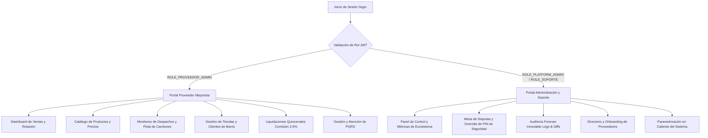

# PRISMA Web Portal (React 19 + Tailwind CSS)

[](https://react.dev)
[](https://vitejs.dev)
[](https://tailwindcss.com)
[](https://lucide.dev)
[](https://reactrouter.com)
[](https://oxc.rs)
[](LICENSE)

Portal web corporativo de la plataforma B2B PRISMA, diseñado para la gestión estratégica, operativa y de auditoría de dos roles fundamentales: Proveedores Mayoristas de Consumo Masivo (CPG) y el Equipo de Administración y Operaciones de PRISMA.

---

## Módulos y Roles del Sistema



### 1. Portal del Proveedor (ROLE_PROVEEDOR_ADMIN)
* **Gestión de Catálogo:** Publicación y actualización en tiempo real de productos, categorías, imágenes y precios sugeridos.
* **Flota y Despachos:** Seguimiento al estado de rutas de distribución asignadas a los camiones y repartidores.
* **Liquidación Financiera:** Visualización clara del corte quincenal de pedidos completados y del porcentaje pactado de intermediación (2.5%).
* **Análisis de Clientes:** Métricas de frecuencia de compra y quiebre de stock por tienda de barrio.

### 2. Portal de Administración y Soporte (ROLE_PLATFORM_ADMIN / ROLE_SOPORTE)
* **Mesa de Resolución de Disputas:** Herramienta operativa para resolver incidentes en ruta (ej. PIN no recibido por tendero) mediante anulación autorizada con justificación obligatoria.
* **Auditoría Forense Inmutable:** Visualización en formato diff de todas las modificaciones y acciones de soporte ejecutadas en la plataforma.
* **Parametrización en Caliente:** Configuración dinámica de comisiones, tiempos máximos de entrega y políticas operativas.

---

## Identidad Visual y Paleta de Colores

La interfaz sigue los lineamientos del manual de identidad corporativa de PRISMA:
* **Amarillo / Ámbar Primario:** `#F59E0B` (Acciones principales, estados destacados y botones de compra).
* **Deep Teal Secundario:** `#1E6F68` (Fondos de navegación, barras laterales y confianza corporativa).
* **Carbón de Contraste:** `#2D2C2D` (Tipografía de alta legibilidad en monitores y laptops).

---

## Stack Tecnológico

| Herramienta | Versión | Propósito |
| :--- | :--- | :--- |
| **React** | `19.2.8` | Librería principal con optimizaciones de concurrencia y hooks |
| **Vite** | `8.3.0` | Empaquetador de alto rendimiento y servidor de desarrollo HMR |
| **Tailwind CSS** | `3.4.19` | Framework CSS utilitario para diseño responsivo |
| **React Router** | `7.18.4` | Enrutamiento declarativo del lado del cliente y protección de rutas |
| **Lucide React** | `1.52.0` | Iconografía vectorizada moderna y ligera |
| **Oxlint** | `1.81.0` | Linter de alto rendimiento en Rust para calidad de código |

---

## Estructura del Proyecto

```
frontend/
├── index.html                 # Punto de entrada HTML5
├── vite.config.js             # Configuración de servidor y plugins Vite
├── tailwind.config.js         # Extensiones de paleta y temas Tailwind
├── postcss.config.js          # Configuración de PostCSS y Autoprefixer
├── package.json               # Dependencias y scripts
├── .env.example               # Plantilla de variables de entorno
├── public/                    # Logotipos, favicons, wireframes e imágenes públicas
└── src/
    ├── main.jsx               # Montaje del Virtual DOM en #root
    ├── App.jsx                # Configuración de rutas y Providers
    ├── App.css / index.css    # Estilos globales y directivas de Tailwind
    ├── context/
    │   └── AuthContext.jsx    # Manejo de estado de autenticación y token JWT
    ├── services/
    │   └── api.js             # Cliente API con manejo dinámico de Base URL
    ├── components/
    │   ├── Navbar.jsx         # Barra de navegación superior con perfil y logout
    │   └── Sidebar.jsx        # Menú lateral adaptativo según el rol (Admin / Proveedor)
    └── pages/
        ├── Login.jsx          # Formulario de acceso con selector de perfil
        ├── admin/             # Vistas de Administrador (Dashboard, Disputas, Auditoría, Proveedores, etc.)
        └── proveedor/         # Vistas de Proveedor (Catálogo, Flota, Liquidaciones, PQRS, Tiendas, etc.)
```

---

## Instalación y Ejecución

### 1. Requisitos Previos
* **Node.js:** Versión 18 LTS o 20 LTS (recomendada).
* **npm:** Versión 9 o superior.

### 2. Configurar Variables de Entorno
Crea un archivo local `.env` a partir de la plantilla:

```bash
cp .env.example .env
```

Contenido por defecto (`.env`):
```env
# URL base para los microservicios / API Gateway de Prisma
VITE_API_URL=/api/v1
VITE_AUTH_API_URL=/api/v1
```

### 3. Instalar Dependencias
```bash
npm install
```

### 4. Modo Desarrollo
```bash
npm run dev
```
La aplicación iniciará en `http://localhost:5173`. Si el backend está levantado en `http://localhost:8080`, Vite redirigirá las peticiones de `/api/v1` de manera transparente.

### 5. Verificación de Código y Linter
```bash
npm run lint
```

### 6. Compilación para Producción (Deploy $0 USD)
```bash
npm run build
```
Los archivos minificados y optimizados se generarán en la carpeta `dist/`, listos para ser desplegados sin costo en plataformas como Vercel, Cloudflare Pages o Render.

Para probar la compilación localmente antes de desplegar:
```bash
npm run preview
```

---

## Equipo y Atribución
Desarrollado en el marco del curso de IETI (Ingeniería de Software y Tecnologías de Internet) en la Escuela Colombiana de Ingeniería Julio Garavito.

* **Organización GitHub:** [ECIPrisma](https://github.com/ECIPrisma)
* **Licencia:** Apache 2.0 - Consulta el archivo [LICENSE](LICENSE) para más detalles.
